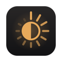
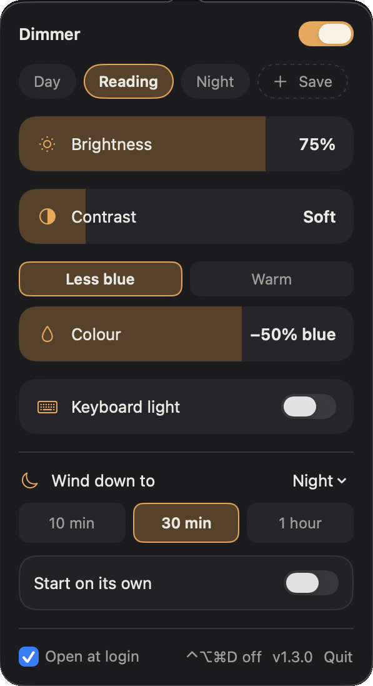

<p align="center"></p>
<h1 align="center">Lowbeam</h1>
<p align="center">Low beams for your MacBook screen.<br>
Takes the screen below its lowest brightness, keeps text readable, cuts blue light and turns the keyboard light off.</p>
<p align="center"><a href="https://github.com/alexerm/lowbeam/releases/latest/download/Lowbeam.dmg"><b>Download for Mac</b></a> · free · macOS 13 or later · Apple silicon and Intel</p>

<p align="center"></p>

## What it does

- **Goes lower than macOS.** Brightness is scaled as light, the way the eye sees it, so grey text stays readable where a simple dimmer turns it into fog.
- **Contrast curve.** Dark pixels fall faster than bright ones, so text keeps its edge at low light.
- **Less blue, or warm.** Cut the blue channel in steps (−25%, −50%, −75%) or warm the screen toward 2700 K. One slider either way.
- **Keyboard light switch.** Turns the keyboard backlight off and back on to the level it had.
- **Presets.** Day, Reading and Night, plus your own. Right-click a preset to update, rename or delete it.
- **Wind down.** Eases toward a preset over 10 minutes to an hour, now or on its own at sunset or a set time.
- **A way back.** <kbd>⌃⌥⌘D</kbd> turns Lowbeam off or on from any app. When a change makes the screen too dark to read, a bright card shows that shortcut.

Lowbeam writes the display's colour table, the same mechanism as Night Shift. It draws no overlay and needs no Screen Recording permission. Location is optional and only finds today's sunset.

Another app that writes the colour table (f.lux, Lunar, BetterDisplay, Iris and similar) resets Lowbeam and the other way round. Lowbeam names that app in its menu when it runs.

## Build

```sh
./test.sh            # logic tests: gamma, easing, sunset, presets, too-dark rule
./build.sh           # universal Lowbeam.app, installed to ~/Applications
SIGN_ID="Developer ID Application: …" NOTARY_PROFILE=… ./release.sh
```

`release.sh` tests, builds, signs, notarizes and staples, then writes `dist/appcast-<version>/appcast.xml` signed with the Sparkle key stored in the login keychain under the account `dimmer`. It prints the `gh release create` command that publishes the zip and the appcast. Installed copies read the appcast from the latest GitHub release.

The keyboard switch uses Apple's private `CoreBrightness` framework, so Lowbeam ships outside the Mac App Store.

## Site

`site/` is the one-page website: plain HTML, no build step. Its comparison demo runs the same transfer formulas the app sends to the display.

## License

MIT
